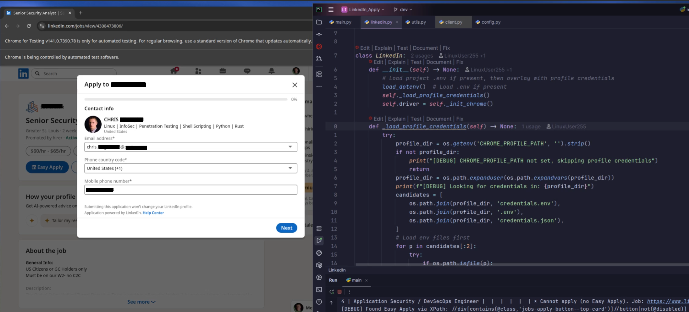

<div align="center">

# LinkedIn Job Application Bot


**Built with**


**[Selenium docs](https://selenium-python.readthedocs.io/)**

</div>


## A Python bot that will apply to the, "Easy Apply", jobs based on your preferences.


*The LinkedIn bot in action - showing the Easy Apply process with IDE debugging view*

- This Bot is based on my earlier [LinkedIn Bot](https://github.com/LinuxUser255/linkedin-application-bot)


 <br>

## Table of Contents
- [Features](#features)
- [Quick Start](#quick-start)
- [Profiles](#profiles)
- [Pausing the Bot](#pausing-the-bot)
- [Tests](#tests)
- [Notes](#notes)
- [Contributing](#contributing)
  - [Development Workflow](#development-workflow)
  - [Guidelines](#guidelines)
  - [Questions or Issues?](#questions-or-issues)

<br>


<div align="left">
  <a href="https://buymeacoffee.com/chrisbingh8" target="_blank">
    
  </a>
</div>


## Features
Using Chromium or Chrome for Testing with ChromeDriver (no Firefox):

- Ability to filter jobs by:
  - Easy Apply, location (Worldwide, Europe, Poland, etc.), keyword (python, react, node), experience, position, job type, and date posted.
- Apply based on your salary preference (works best for U.S. job offers).
- Automatically apply to single-page jobs requiring just CV and contact.
- Automatically apply to multi-page offers using saved LinkedIn info (experience, legal rights, resume, etc.).
- Output results to `data/<profile>/` text files for later review.
- Print links for jobs the bot couldn't apply to due to extra requirements (for manual follow-up).
- Randomized time breaks between actions to avoid thresholds.
- Automatically runs in the background (headless mode optional).
- Several people (or setups) can each have their own profile: login, resume, answers and job search.
- Optional: follow or not follow company after successful application.

<br>

## Quick Start

> **Before you start:** the bot submits real job applications under your name, using the answers you give it. Check your answers carefully, and review `data/<profile>/` after a run. Automating LinkedIn may go against LinkedIn's User Agreement, so use it at your own risk.

**What you need**
- Python 3.10 or newer. Check with `python3 --version`. On a Mac, the built-in Python is too old (3.9), so install one from [python.org](https://www.python.org/downloads/) or with `brew install python`.
- macOS or Linux. On Windows, see [Windows](#windows) below.

**1. Download the bot and install what it needs** (one time)
```shell
git clone https://github.com/LinuxUser255/LinkedIn_Apply.git
cd LinkedIn_Apply
bash setup_venv.sh
```
No git? On the GitHub page, click **Code → Download ZIP**, unzip it, and open a terminal in that folder instead of running the first two lines.

**2. Get a browser and ChromeDriver** (one time)

Selenium controls the browser through a program called ChromeDriver. The two must match: ChromeDriver's version has to start with the same number as the browser's (for example, both 129). Pick **one** of these options:

<details open>
<summary><b>Option A: Chromium</b> (what this bot was originally built and used with)</summary>

[Chromium](https://www.chromium.org/Home/) is the open-source browser that Chrome is built on.

- **Linux:** install Chromium and its ChromeDriver with your package manager. On Debian: `sudo apt install chromium chromium-driver`. On Ubuntu: `sudo apt install chromium-browser chromium-chromedriver`.
- **macOS or Windows:** go to [Download Chromium](https://www.chromium.org/getting-involved/download-chromium/) and open the snapshot builds for your platform. Pick the newest build number, and from that **same build folder** download both the `chrome-…zip` file and the `chromedriver_…zip` file. Unzip both, then move the unzipped folders (for example `chrome-mac/` and `chromedriver_mac64/`) into the `LinkedIn_Apply` folder.

Chromium installed in `/usr/bin`, `/snap/bin` or `/Applications` is also found automatically.

</details>

<details>
<summary><b>Option B: Chrome for Testing</b></summary>

1. Open [googlechromelabs.github.io/chrome-for-testing](https://googlechromelabs.github.io/chrome-for-testing/) and find the **Stable** section.
2. Find your platform:
   - `mac-arm64` for Macs with an Apple chip (M1, M2, …). Check under Apple menu → About This Mac.
   - `mac-x64` for Intel Macs.
   - `linux64` for Linux.
   - `win64` for Windows.
3. Open the URL for **chrome** and the URL for **chromedriver** on your platform to download both zip files.
4. Unzip both, then move the two unzipped folders into the `LinkedIn_Apply` folder:
   ```
   LinkedIn_Apply/
   ├── chrome-mac-arm64/
   ├── chromedriver-mac-arm64/
   ├── main.py
   └── ...
   ```

</details>

The bot finds the browser and ChromeDriver by itself. Downloaded folders are ignored by git. If both browsers are present, the one unzipped into the project folder is used (Chrome for Testing before Chromium).

On a Mac, if you get a message that the browser or "chromedriver" can't be opened, run this once in the `LinkedIn_Apply` folder for the folders you downloaded:
```shell
xattr -cr chrome-mac* chromedriver*
```
For Chromium installed in Applications, run `xattr -cr /Applications/Chromium.app` instead.

**3. Create your profile** (about 5 minutes)
```shell
source .venv/bin/activate
python3 main.py setup
```
The bot asks one question at a time: your LinkedIn email, contact details, resume, work eligibility, and what jobs to search for. Press Enter to keep the answer shown in [brackets]. Only the email and the job keywords are required.

Tip: leave the password blank. You'll sign in yourself in Chrome on the first run, which also gets you past LinkedIn's security checks, and no password is stored.

**4. Run the bot**
```shell
python3 main.py
```
A Chrome window opens on LinkedIn. On the first run, sign in there; the terminal tells you when the bot is waiting for you. Chrome remembers the login for the next runs. Then leave the window alone while the bot searches and applies.

- **To stop:** press `Ctrl+C` in the terminal, then close Chrome. The next run continues where it stopped and skips jobs it already handled.
- **Results:** in `data/<profile>/`. `Applied Jobs DATA - <date>.txt` lists every job and what happened. `failed_jobs.txt` lists the ones that need you. Those jobs are also saved on LinkedIn (**My Jobs → Saved**) so you can apply by hand.
- **Daily limit:** LinkedIn caps Easy Apply submissions per day. The bot stops by itself when it reaches the cap; run it again tomorrow.

**Next time**, open a terminal in the `LinkedIn_Apply` folder and run:
```shell
source .venv/bin/activate
python3 main.py
```

#### Windows

The setup script needs macOS or Linux. Do step 2 with the Windows downloads, then run these in PowerShell instead (not tested on Windows):
```powershell
py -m venv .venv
.venv\Scripts\activate
pip install -r requirements.txt
python main.py setup
python main.py
```

<br>

## Profiles

Each profile is a separate person: their own LinkedIn login, resume, form answers, job search settings and results. This lets several people share one copy of the bot, or one person keep separate setups.

| Command | What it does |
|---|---|
| `python3 main.py setup` | Create a new profile |
| `python3 main.py setup NAME` | Change an existing profile's answers |
| `python3 main.py list` | Show your profiles |
| `python3 main.py` | Run the bot (asks which profile if you have several) |
| `python3 main.py --profile NAME` | Run the bot for one profile |

Profiles are stored outside the project, in `~/.config/LinkedIn_Apply/profiles/<name>/`:
- `profile.json` holds your answers (only your user account can read it). You can edit it directly, but `python3 main.py setup NAME` is easier.
- `dynamic_questions.json` holds answers to extra application questions. See [docs/DYNAMIC_FORMS.md](docs/DYNAMIC_FORMS.md).
- `chrome/` is that profile's Chrome data, which keeps it signed in.

**Do not commit or share these files.**

If you used an older version of the bot with a `.env` file or `~/.config/LinkedIn_Apply_Profile/credentials.json`, the first `python3 main.py setup` fills those values in for you.

<br>

## Pausing the Bot

From a second terminal:
```shell
./control_bot.sh pause NAME    # pause after the current search
./control_bot.sh resume NAME
./control_bot.sh status NAME
```

<br>

## Tests

Unit tests (no browser or LinkedIn account needed):
```shell
pip install -r requirements-dev.txt
pytest
```

Setup checks:
- `python3 tests/setup_tests.py` shows whether Python, pip, selenium and dotenv are installed.
- `python3 tests/selenium_test.py` checks that Selenium can load a website.

<br>

## Notes
- Hide the Chrome window by answering Yes to "Hide the Chrome window" in setup. Keep it visible for your first run so you can sign in.
- To use a browser installed somewhere else, set `CHROME_BINARY=/path/to/browser` in your shell. Its version must match ChromeDriver's.
- When you update the browser, update ChromeDriver at the same time so the versions still match.

<br>

## Contributing

Contributions are welcome! Please follow these guidelines:

### Development Workflow
**1. Fork the repository**

   ```shell
   git clone https://github.com/YOUR_USERNAME/LinkedIn_Apply.git
   cd LinkedIn_Apply
   ```
<br>

**2. Create a new branch from `dev` for your feature:**
   ```shell
   git checkout dev
   git pull origin dev
   git checkout -b feature/your-feature-name
   ```
<br>

**4. Make your changes and test thoroughly & Commit with clear, descriptive messages:**
   ```shell
   git add .
   git commit -m "Add feature: description"
   ```
<br>

**5. Push to your fork:**
   ```shell
   git push origin feature/your-feature-name
   ```
<br>

**6. Open a Pull Request against the `dev` branch (not `main`)**

### Guidelines
- All PRs should target the `dev` branch
- The `main` branch is for stable releases only
- Follow existing code style and conventions
- Test your changes before submitting
- Update documentation if needed
- Do not commit credentials, secrets, or personal information

### Questions or Issues?
Feel free to open an issue for bugs, feature requests, or questions.

<br>
